# Cisco Router Monitoring and Manual Fault Recovery Lab (SNMP + Syslog + SSH)

A small network operations lab built around a Cisco router and an Ubuntu monitoring server. It demonstrates a realistic, small-scale **detect → investigate → remotely access → remediate → verify** workflow: the router is monitored over SNMP and centralized syslog, an interface failure is simulated, the event is observed through both monitoring paths, and the interface is manually restored over SSH and verified.

> **Lab note:** This is a hands-on lab in an isolated EVE-NG environment. The remediation shown here is a **manual** SSH fix performed by me, not an automated recovery system.

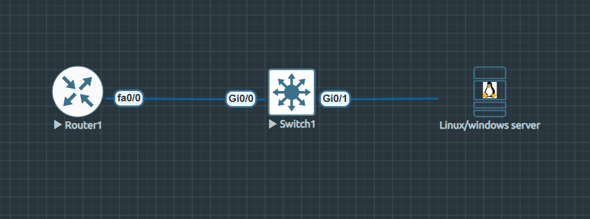

*Topology: Cisco Router1 connects through Switch1 to the Ubuntu monitoring server (also running Windows Server as a secondary SNMP target).*

---

## Overview

I built this lab to practice the fundamentals of network operations monitoring: getting a device's real-time status through SNMP, getting event context through centralized syslog, and combining both with remote SSH access to actually fix a problem. The core exercise was simulating a router interface going down and walking through the full cycle of noticing it, confirming it two different ways, fixing it remotely, and proving the fix worked.

## Project Objectives

- Configure SNMP polling from a Linux monitoring server against a Cisco router
- Configure centralized syslog collection on the same server, with the router's events isolated to their own log file
- Simulate an interface failure and observe it through both SNMP and syslog
- Use SSH to remotely and manually restore the interface
- Verify recovery through SNMP after the fix
- Document what worked, what didn't, and why

## Lab Environment and Tools

| Component | Role |
|---|---|
| EVE-NG Community | Hosts the Cisco router and switch |
| Cisco 7200 (IOS 12.4(24)T5, C7200-ADVENTERPRISEK9-M) | Monitored device |
| Ubuntu Server | SNMP polling, syslog collection, SSH client |
| Windows Server | Secondary/supplementary SNMP target (optional, see below) |

## Confirmed Topology

| Device | Interface | Address |
|---|---|---|
| Router1 | FastEthernet0/0 | `192.168.50.1/24` |
| Ubuntu monitoring server | `ens38` | `192.168.50.2/24` |
| Windows Server (supplementary) | `Ethernet1` | `192.168.50.3/24` |

The Ubuntu server also keeps its existing management/SSH interface (`ens37`, `192.168.138.143/24`) separate from the lab network — that route wasn't touched.

```
Ubuntu Server ens38 (192.168.50.2)
        |
        | SNMP polling      · UDP 161
        | Syslog receiving  · UDP 514
        | SSH administration· TCP 22
        |
Router1 Fa0/0 (192.168.50.1)
```

---

## How the Monitoring Workflow Works

- **SNMP** gives the monitoring server a queryable value for interface status — good for "what is the state right now."
- **Syslog** gives an event trail — good for "what changed, and when."
- **SSH** gives the operator a way to act on what the other two revealed.

None of these three replace the others. SNMP alone doesn't tell you *why* an interface went down (an administrative shutdown looks the same as anything else that flips the same value), and syslog alone doesn't let you poll current state on demand. Using them together is the point of the exercise.

## Ubuntu rsyslog Configuration

The UDP syslog listener was enabled in `/etc/rsyslog.conf`:

```
module(load="imudp")
input(type="imudp" port="514")
```

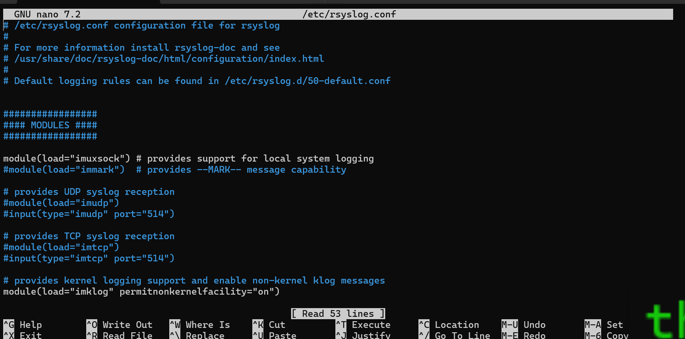

Router1's messages were routed to their own file rather than the general syslog, via `/etc/rsyslog.d/router1.conf`:

```
if $fromhost-ip == '192.168.50.1' then /var/log/router1.log
& stop
```

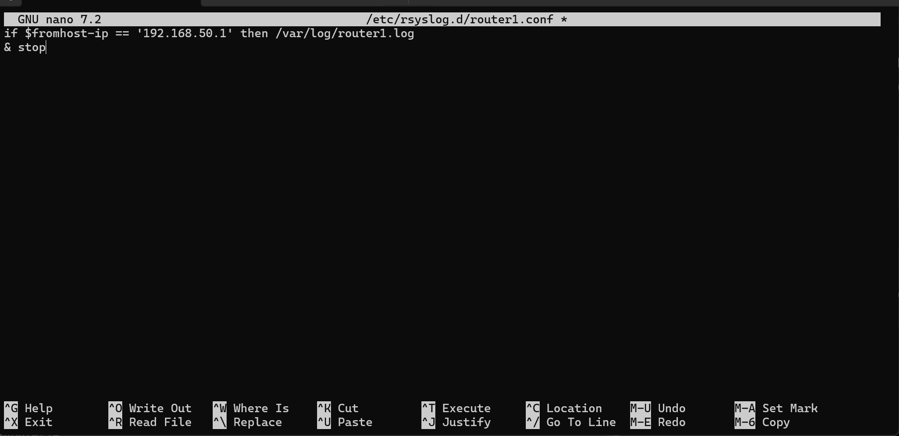

After a restart, `systemctl status rsyslog` confirmed the service was active:

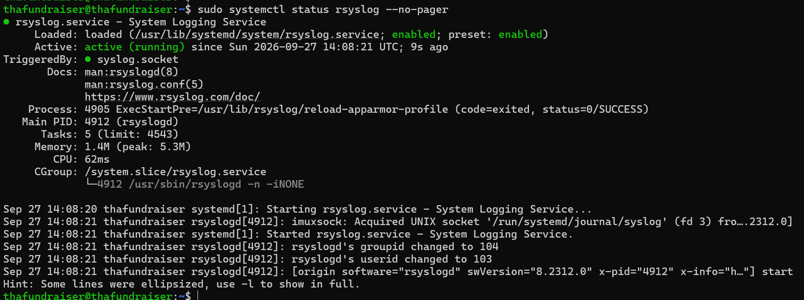

Router1 was pointed at the server:

```
logging host 192.168.50.2
logging trap info
```


## Cisco Router SNMP Configuration

A read-only SNMP community was configured on Router1:

```
snmp-server community SNMPLab RO
snmp-server location "EVE-NG Lab"
snmp-server contact "Network Lab"
```

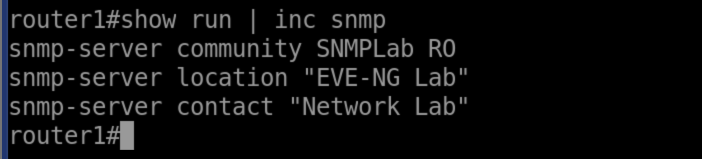

`SNMPLab` is a **lab-only, read-only** community string — SNMPv2c community strings are not encrypted, so this is not a pattern suitable for a production network (see [Security Considerations](#security-considerations)).

## SNMP Validation

`net-snmp` tools were installed on Ubuntu:

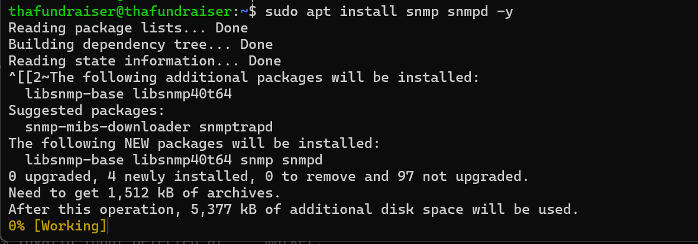

The first `snmpget` attempts against the router timed out with no response. I confirmed the request was actually reaching the router with `tcpdump` on `ens38` — the GetRequest packets were leaving Ubuntu and arriving at `192.168.50.1:161`, but nothing came back:

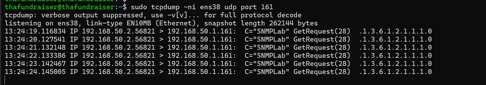

Once the community configuration was corrected, the query succeeded and returned the router's system description:

```
snmpget -v2c -c SNMPLab 192.168.50.1 1.3.6.1.2.1.1.1.0
```

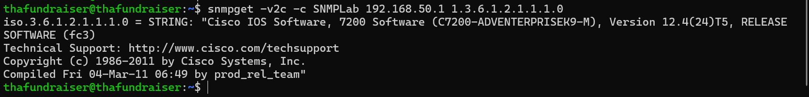

`show snmp` on the router confirmed the request/response counters had incremented, proving the round trip actually worked rather than just the client reporting success:

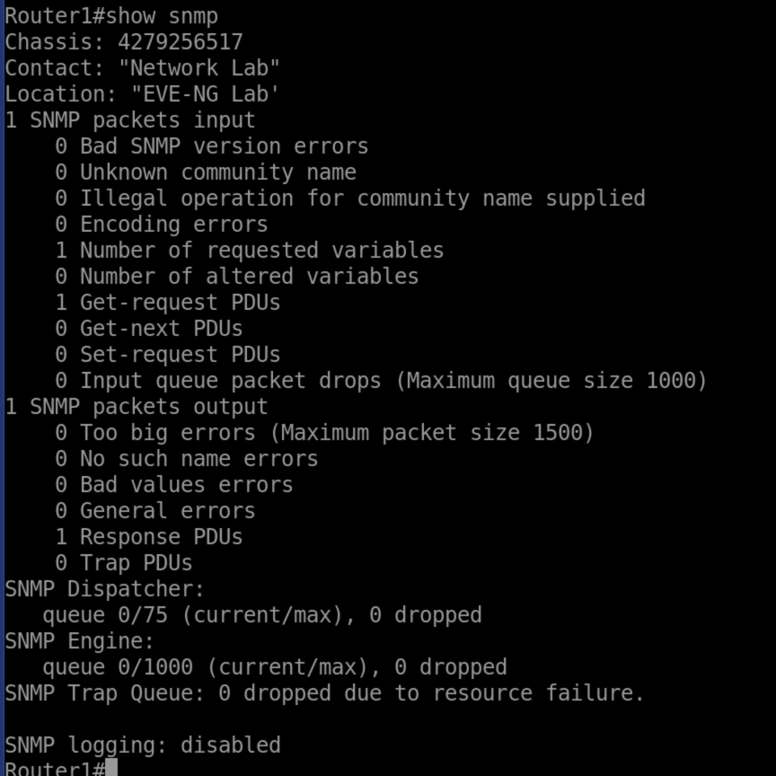

Walking the interface table (`1.3.6.1.2.1.2.2.1.2`) identified the interfaces and their index numbers:

- ifIndex 1: FastEthernet0/0
- ifIndex 2: FastEthernet1/0
- ifIndex 3: VoIP-Null0
- ifIndex 4: Null0


The interface status OID used throughout was `1.3.6.1.2.1.2.2.1.8.<ifIndex>`, returning `INTEGER: 1` for up and `INTEGER: 2` for down. This value reflects the interface's administrative/operational state as the router reports it — it doesn't by itself tell you *why* the interface is in that state, only *that* it is.

## SSH Access Configuration

SSH was enabled on Router1 with a local admin account, 2048-bit RSA keys, SSH version 2, and the VTY lines restricted to SSH with local login. (The configuration screenshot for this step included a visible lab password, so it's intentionally left out of this repository — the working login below is the evidence that the configuration was correct.)

Because Router1 runs an older IOS image with legacy SSH algorithms, Ubuntu needed compatibility options to connect:

```
ssh -o KexAlgorithms=+diffie-hellman-group14-sha1 \
    -o HostKeyAlgorithms=+ssh-rsa \
    -o PubkeyAcceptedAlgorithms=+ssh-rsa \
    -o Ciphers=+aes128-cbc \
    admin@192.168.50.1
```

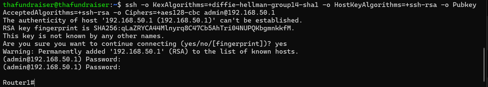

**These options exist only to interoperate with this lab's old IOS SSH implementation.** They are not a security recommendation, and shouldn't be carried into a modern production environment.

---

## Controlled Interface-Failure Test

The demonstration used **FastEthernet1/0 (ifIndex 2)** — a dedicated test interface, separate from Fa0/0, which carries the monitoring/management traffic for the whole lab network. (See [Troubleshooting Notes](#troubleshooting-notes-and-lab-limitations) for why that separation mattered.)

**1. Baseline — confirm the interface is up via SNMP**


**2. Simulate the failure — administratively shut the interface**

```
Router1(config)#int fa1/0
Router1(config-if)#shut
```

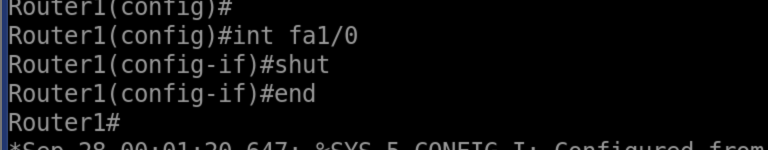

`show ip int br` on the router confirms the interface is now administratively down:

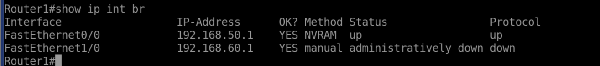

**3. Detect via SNMP**

```
snmpget -v2c -c SNMPLab 192.168.50.1 1.3.6.1.2.1.2.2.1.8.2
```


**4. Detect via syslog**

With `tail -f /var/log/router1.log` running on Ubuntu, the router's own event messages arrived showing the interface's state change, followed later by the recovery — this single capture spans both the failure and the recovery:

```
%LINK-3-UPDOWN: Interface FastEthernet1/0, changed state to administratively down
%LINEPROTO-5-UPDOWN: Line protocol on Interface FastEthernet1/0, changed state to down
...
%LINK-3-UPDOWN: Interface FastEthernet1/0, changed state to up
%LINEPROTO-5-UPDOWN: Line protocol on Interface FastEthernet1/0, changed state to up
```

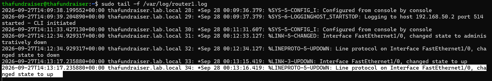

Syslog and SNMP are telling a consistent but different story here: syslog shows the *transition events*, SNMP shows the *current value*. Neither one is redundant with the other.

**5. SSH in and manually restore the interface**

```
ssh -o KexAlgorithms=+diffie-hellman-group14-sha1 -o HostKeyAlgorithms=+ssh-rsa \
    -o PubkeyAcceptedAlgorithms=+ssh-rsa -o Ciphers=+aes128-cbc admin@192.168.50.1

Router1(config)#int fa1/0
Router1(config-if)#no shut
```

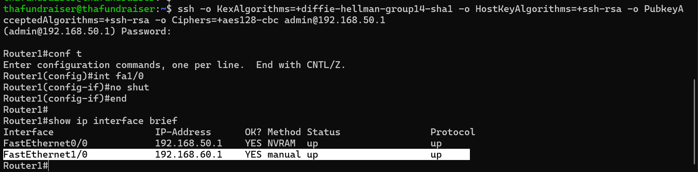

This step was performed by me, typing the command over an interactive SSH session — SNMP did not trigger it, and nothing on Ubuntu ran it automatically.

**6. Verify recovery via SNMP**

```
snmpget -v2c -c SNMPLab 192.168.50.1 1.3.6.1.2.1.2.2.1.8.2
```


This was a **lab simulation of an administratively shut interface** — not a physical cable fault, a hardware failure, or a real customer-facing outage. The value of the exercise is in the monitoring/detection/remediation/verification cycle, not in the specific failure mode.

---

## Troubleshooting Notes and Lab Limitations

**Shutting down the wrong interface first.** Before settling on Fa1/0 for the controlled test, I initially shut down **Fa0/0** — which is the interface carrying the monitoring path for the entire `192.168.50.0/24` lab network.

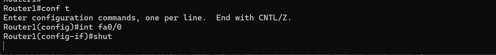

The result was that the SNMP query itself timed out with no response — not because SNMP was broken, but because the path to reach the router at all had just been cut:


I restored the interface with `no shut` and confirmed it back up:

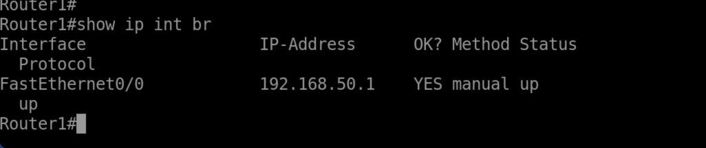

and used the dedicated **Fa1/0** interface for the actual controlled failure/recovery demonstration instead. The lesson carries over to the Windows supplementary test below: **if you shut down the interface a monitoring tool depends on to reach a host, you lose the ability to monitor that same host over that path** — a timeout in that situation isn't proof the monitoring protocol itself is broken.

**Initial SNMP timeouts.** The first `snmpget` attempts against the router also timed out before the community configuration was corrected — see [SNMP Validation](#snmp-validation) above for the `tcpdump` evidence used to confirm the request was reaching the router.

**Not implemented / out of scope.** Two things were explored briefly and intentionally left out of the finished project: forwarding Windows Server events into the Ubuntu syslog server (no forwarding agent was ever installed or configured), and an additional Windows-to-router network path on a separate subnet, which didn't achieve working connectivity in testing. Neither was needed for the core monitoring/recovery workflow above, so neither is part of the completed design.

---

## Supplementary Windows Server SNMP Test (Optional)

Separately from the router monitoring workflow, Windows Server was set up as a second SNMP target to practice the same querying skills against a different platform. This was **SNMP testing only** — it is not integrated into the syslog collection workflow above.

```
Install-WindowsFeature -Name SNMP-Service
```

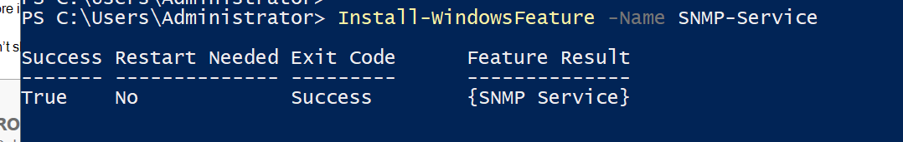

The SNMP community and permitted-manager registry values were set to accept read-only requests from the Ubuntu server only, and an inbound firewall rule was added for UDP 161 from `192.168.50.2`:

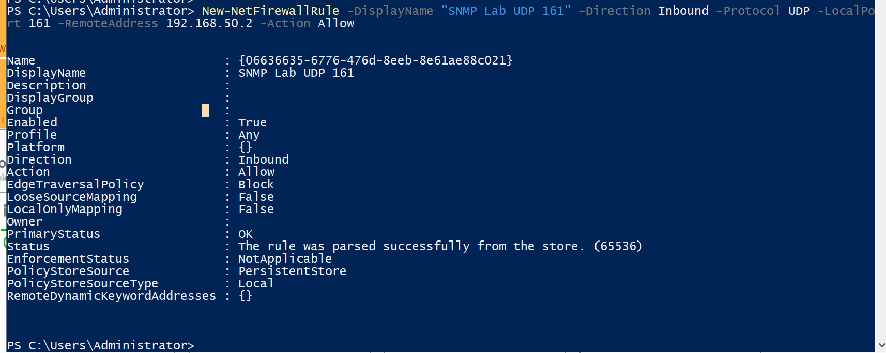

A query from Ubuntu against Windows Server then succeeded:

```
snmpget -v2c -c SNMPLab 192.168.50.3 1.3.6.1.2.1.1.1.0
```

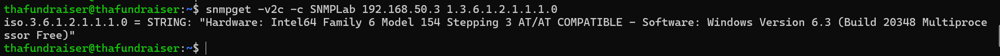

As a small troubleshooting observation, disabling the network adapter that was carrying the SNMP traffic caused the same kind of timeout seen on the Fa0/0 test above:


This wasn't a valid way to remotely detect the status of that same interface while it was down — it's a reminder that monitoring reachability depends on the path staying up, the same lesson as the Fa0/0 test.

---

## Security Considerations

- `SNMPLab` is a **lab-only, read-only** SNMP community string. SNMPv2c community strings are transmitted without encryption, so this is not suitable for a production network as-is. **SNMPv3 with authentication and privacy (authPriv)** would be the natural next step for anything beyond a lab.
- The legacy SSH algorithm options used to reach Router1 (`diffie-hellman-group14-sha1`, `ssh-rsa`, `aes128-cbc`) exist only because of the old IOS image in this lab. They are not a hardening recommendation and shouldn't be reused against a modern device.
- No passwords or credentials are published in this repository. One router configuration screenshot that displayed a lab password in plain text was intentionally left out entirely, rather than cropped or edited.
- This is an isolated EVE-NG lab. Nothing here reflects a production monitoring or logging deployment (no alerting, no log retention policy, no dashboards).

## What I Learned

- How to get a live, queryable device status out of SNMP, and how that's a different (and complementary) kind of evidence to a syslog event trail.
- How to read `tcpdump` output to confirm whether a request is actually reaching a device, which turns "it's not working" into an actual diagnosis instead of a guess.
- That a monitoring timeout doesn't always mean the monitored protocol is broken — twice in this lab (Fa0/0 on the router, then the Windows adapter), a timeout turned out to be a lost path rather than a broken service.
- Why the interface you use to reach a device shouldn't be the same interface you're testing failures against.
- Why verification after a fix matters — confirming recovery through an independent channel (SNMP, after an SSH fix) is different from just assuming the command worked.

## Future Improvements

- Move from SNMPv2c to SNMPv3 with authentication and encryption.
- Add basic alerting (e.g., a threshold or trap-based notification) instead of manual polling.
- Extend syslog collection to more devices with per-device log separation, as already done for Router1.
- Revisit Windows Event Log forwarding into the central syslog server, which was considered but not implemented here.

## AI-Use Disclosure

AI assistance was used to help organize this documentation, write explanations, and review the screenshot evidence for consistency with what was actually configured and tested. All lab work, configuration, and testing shown here was performed by me; the screenshots and command output are the evidence I captured during the lab.

---

## Repository Structure

```
README.md
images/
    topology/               - lab topology diagram
    setup/                  - base router/Ubuntu addressing and connectivity
    snmp/                   - SNMP configuration and validation
    syslog/                 - rsyslog configuration and service status
    ssh/                    - SSH access to the router
    failure-recovery/       - the controlled failure/recovery demonstration
    troubleshooting/        - the Fa0/0 mis-shutdown and SNMP timeout evidence
    supplementary-windows/  - optional Windows Server SNMP test
configs/
    cisco/                  - sanitized SNMP, logging, and SSH config snippets
    ubuntu/                 - rsyslog configuration snippets
    windows/                - SNMP service setup script
raw-screenshots/            - the full, unedited set of screenshots captured
                              during the lab (source material; not all of it
                              is referenced above)
```
